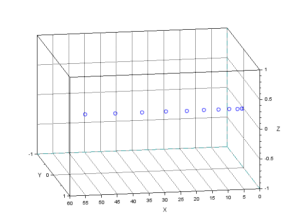
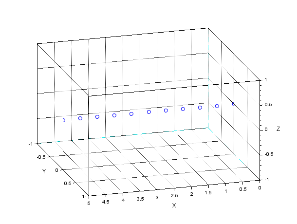
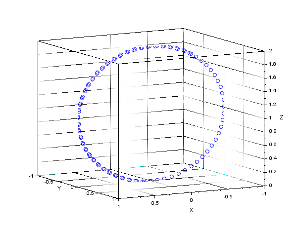
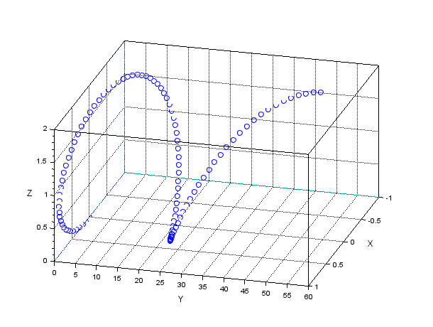
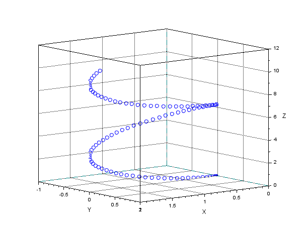
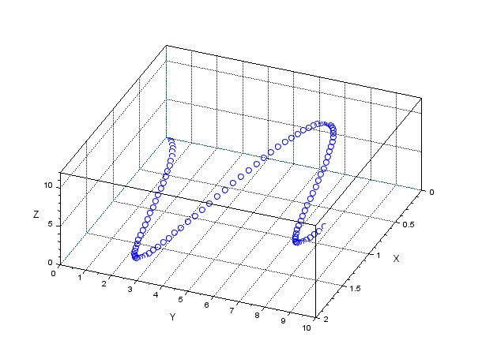

# Lorentz force trajectories

**Charged-particle motion in electric and magnetic fields**

[](LICENSE)
[](https://www.python.org/)
[](https://www.scilab.org/)

This project integrates the Lorentz force for a charged particle in uniform
electric and magnetic fields. The original Scilab code uses `ode` on a
six-component state vector. The Python version uses `solve_ivp` and adds a 3D
animation with live controls for the fields and particle parameters.

**Author:** Zain Ul Abideen
**GitHub repository:** [dominuszain/TheoreticalPlasmaPhysics](https://github.com/dominuszain/TheoreticalPlasmaPhysics)

## Results

| | |
|---|---|
|  |  |
|  |  |
|  |  |

## Python simulation

```bash
cd python
pip install numpy scipy matplotlib
python lorentz_simulation.py
```

Use the sliders to change `q`, `m`, `E`, and `B`. The preset buttons reproduce
cyclotron motion, a helix, linear acceleration, and **E × B** drift. See
[`python/README.md`](python/README.md).

## Original Scilab code

Open `main.sce` in Scilab and run it. The state vector is
`[x, y, z, vx, vy, vz]`, and the script integrates

```
dv/dt = (q/m) (E + v × B)
```

with Scilab's `ode`. The course report is [`main.pdf`](main.pdf).

## Repository layout

```
.
├── python/           # interactive Python simulation
├── docs/figures/     # example trajectories
├── main.sce          # original Scilab code
├── main.pdf          # course report
├── CITATION.cff
└── LICENSE
```

## Citation

```bibtex
@software{ulabideen_lorentz_2026,
  author = {Ul Abideen, Zain},
  title  = {Lorentz force trajectories},
  year   = {2026},
  url    = {https://github.com/dominuszain/TheoreticalPlasmaPhysics}
}
```

## License

Released under the [MIT License](LICENSE).
